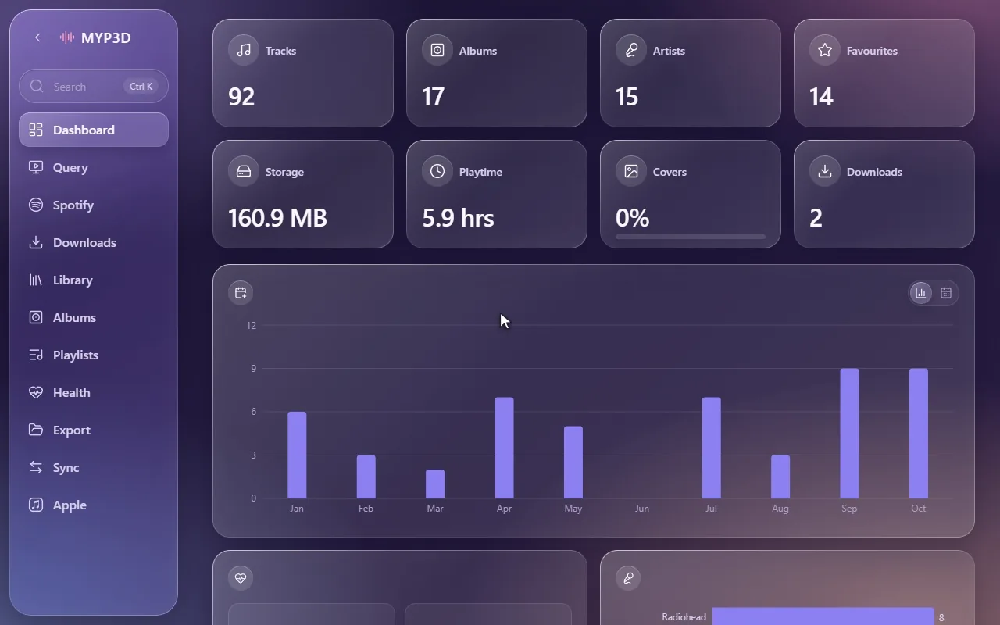
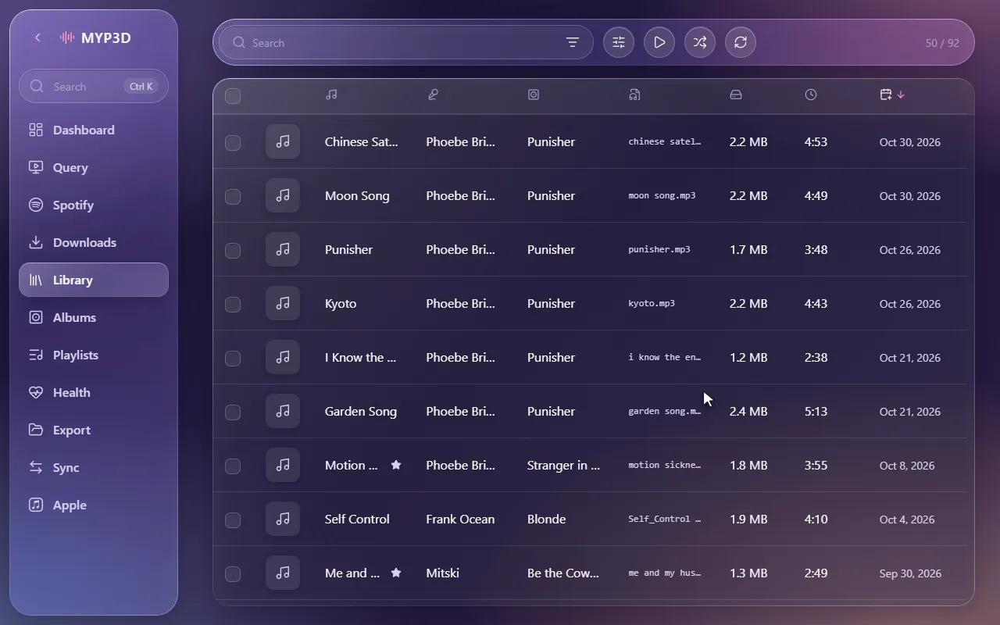
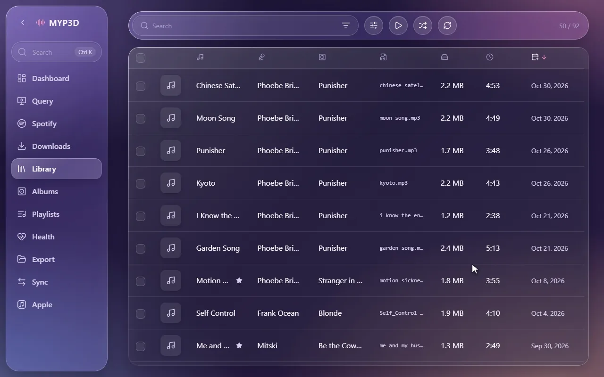
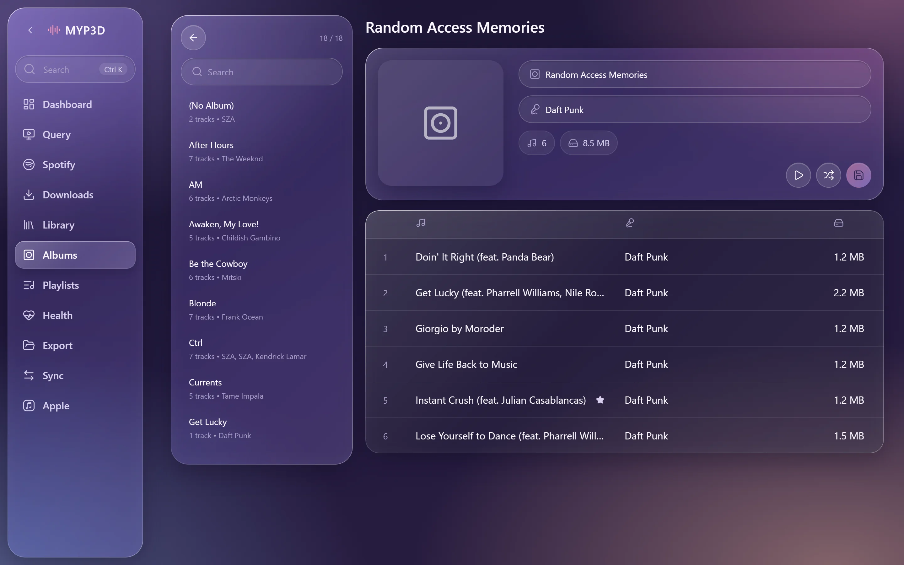

# myp3d

A YouTube-to-MP3 downloader and music library that runs on your own machine. FastAPI backend, React frontend.



<table>
  <tr>
    <td><a href="docs/screenshots/library.webp"></a></td>
    <td><a href="docs/screenshots/spotlight.webp"></a></td>
    <td><a href="docs/screenshots/album.webp"></a></td>
  </tr>
</table>

## Features

- Search YouTube, trim, tag and crop cover art, then download now or add to the download queue
- Import Spotify tracks, albums and playlists, matched against YouTube Music (explicit versions first)
- Edit tags and covers one song, one album or many songs at a time
- Albums, playlists, favourites and a player with a queue
- A dashboard of library stats and a Health page that finds silent endings, untidy file names and songs with several artists
- Spotlight search across pages, songs, albums, playlists, YouTube and Spotify
- Sync two libraries over your local network
- Sync songs, playlists and favourites with Apple Music (macOS)
- Export every song, or every album cover, as a zip

## Setup

You need Python 3.10+, [Node](https://nodejs.org) 20.19+ or 22.12+ and [ffmpeg](https://ffmpeg.org/download.html).

```bash
git clone https://github.com/Lonjz/myp3d.git
cd myp3d
```

| | |
| --- | --- |
| macOS / Linux | `./scripts/setup-mac.sh` |
| Windows (PowerShell) | `powershell -ExecutionPolicy Bypass -File scripts\setup-win.ps1` |

The script checks your Python and Node versions, installs the backend and frontend packages, and tells you what to run next. It's safe to run again.

It won't install ffmpeg for you. On Windows you can put `ffmpeg.exe` in `myp3d-backend/`. Otherwise install ffmpeg so it's on your `PATH`.

### Docker

myp3d talks to your music folder, your LAN and your Music app. It's an MP3 downloader. It can live in a venv like the rest of us.

## Running

Start both servers from the repo root, then open http://localhost:5173.

| | |
| --- | --- |
| macOS / Linux | `./scripts/dev-mac.sh` |
| Windows (PowerShell) | `powershell -ExecutionPolicy Bypass -File scripts\dev-win.ps1` |
| Windows (Windows Terminal) | `scripts\dev-win.bat` |

`scripts/update-ytdlp-mac.sh` and `scripts\update-ytdlp-win.bat` update yt-dlp. When downloads start failing, YouTube has usually changed something and an update fixes it.

### Shortcuts

| Keys | |
| --- | --- |
| Ctrl/⌘ K or `/` | Search |
| Space | Play or pause |
| Ctrl/⌘ S | Save on an edit page |
| `?` | All shortcuts |

## Config

Backend settings go in `myp3d-backend/.env`. Copy `.env.example` to start.

| Variable | Default | |
| --- | --- | --- |
| `MYP3D_LIBRARY_DIR` | `myp3d-backend/downloads` | Where your MP3s live |
| `MYP3D_DB_PATH` | `myp3d-backend/myp3d.db` | Playlists, favourites, the download queue and sync state |
| `API_PORT` | `8000` | Backend port |
| `API_RELOAD` | `false` | Restart the backend when its code changes |
| `USE_SYSTEM_FFMPEG` | `false` | Ignore `ffmpeg.exe` and use ffmpeg from `PATH` |
| `YTDLP_COOKIES_BROWSER` | | Browser to borrow YouTube cookies from when YouTube asks to sign in, such as `firefox` ([why](https://github.com/yt-dlp/yt-dlp/wiki/FAQ#how-do-i-pass-cookies-to-yt-dlp)) |
| `YTDLP_COOKIES_PROFILE` | | Browser profile name or path |
| `YTDLP_PLAYER_CLIENTS` | `default,tv,ios` | YouTube clients yt-dlp tries, in order ([details](https://github.com/yt-dlp/yt-dlp#youtube)) |

If you change the port, copy `myp3d-frontend/.env.example` to `myp3d-frontend/.env` and update `VITE_API_BASE_URL` to match.

## Spotify

Paste track, album or playlist links on the Spotify page. Spotify only shows the first 100 songs of a playlist, so for longer or private playlists export a CSV at [exportify.net](https://exportify.net) and drop it on the page. No Spotify account or API key is needed.

## Apple Music (macOS)

The Apple Music page syncs songs, playlists and favourites with the Music app.

- The first sync asks to control Music. If you said no, allow it in System Settings → Privacy & Security → Automation.
- Point the page at your Apple Music media folder. It's usually found for you.

## LAN sync

The Sync page finds other computers running myp3d on the same network and syncs both ways once both sides accept.

- Both computers need the Sync page open, on the same discovery port (47817 unless you change it).
- Discovery uses UDP on that port. Songs travel over the backend port (`API_PORT`). Allow Python through the firewall on private networks when asked.
- Songs are only ever added, never deleted. Playlists, favourites and the download queue follow the most recent change, including deletions.
- Deletions are remembered for 180 days. A computer that hasn't synced in longer may bring them back.
- Both computers need the same major version of myp3d.

## Development

```bash
cd myp3d-backend && venv/bin/python -m pytest tests     # Windows: venv\Scripts\python -m pytest tests
cd myp3d-frontend && npm test -- --run && npm run lint && npm run build
```

The tests never touch your library. To click around without it, run the sandbox, which starts the app at http://localhost:5174 on a sample library: real song names over generated tones, with no cover art:

```bash
./scripts/dev-sandbox.sh   # Windows: powershell -ExecutionPolicy Bypass -File scripts\dev-sandbox.ps1
```

The first run generates about 160 MB of audio in `myp3d-backend/tests/.sandbox/`. Add `--reset` to rebuild it.

## Notes

- The API only answers requests from the app on the same machine. Other computers can only reach the sync routes under `/peer`.
- Interactive API docs are at http://localhost:8000/docs.
- Only download things you have the right to.

## License

[MIT](LICENSE)
