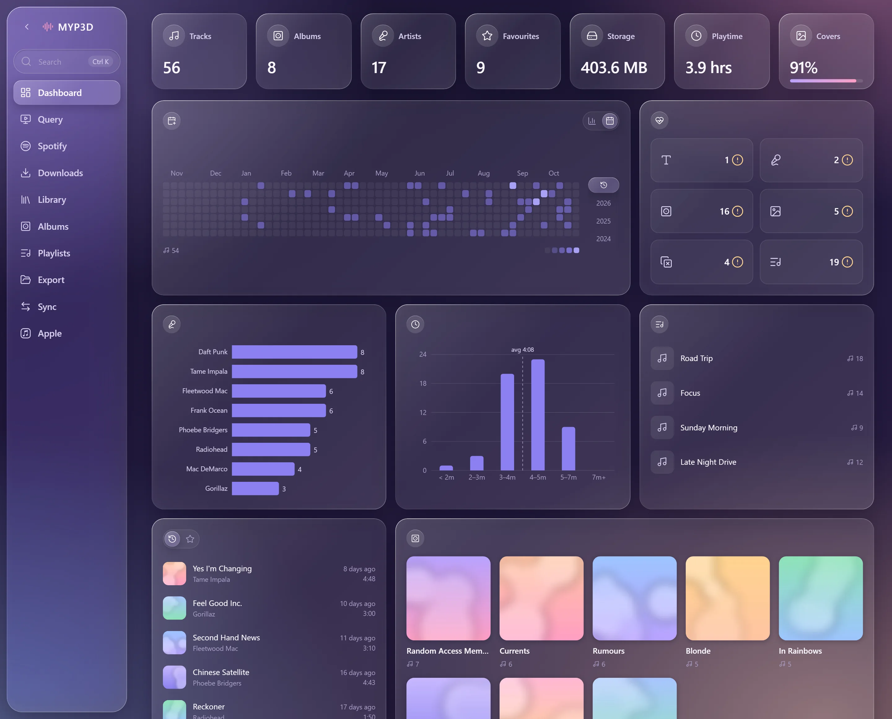
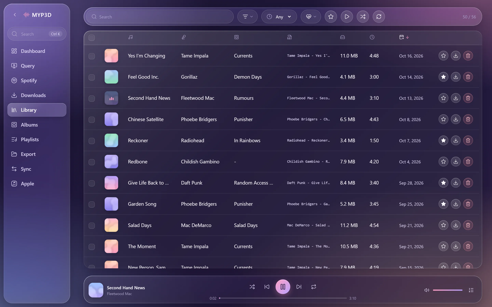
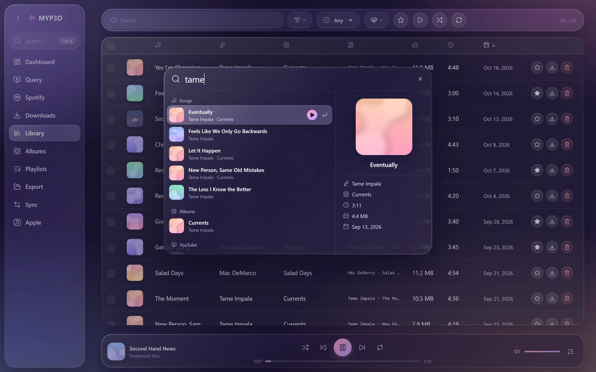
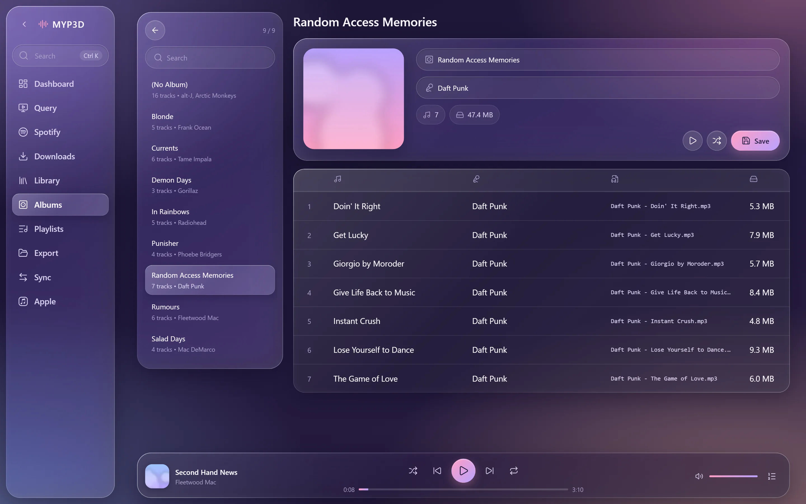

# myp3d

A YouTube-to-MP3 downloader and music library that runs on your own machine. FastAPI backend, React frontend.



<table>
  <tr>
    <td><a href="docs/screenshots/library.webp"></a></td>
    <td><a href="docs/screenshots/spotlight.webp"></a></td>
    <td><a href="docs/screenshots/album.webp"></a></td>
  </tr>
</table>

## Features

- Search YouTube, trim, tag and crop cover art, then queue downloads
- Import Spotify playlists and albums, matched against YouTube Music
- Edit tags and covers one at a time or in bulk, and find duplicates or missing tags
- Albums, playlists, favourites and a player with a queue
- Sync two libraries over your local network
- Sync songs, playlists and favourites with Apple Music (macOS)
- Export tracks or album art as a zip

## Setup

You need Python 3.10+, [Node](https://nodejs.org) 20.19+ and [ffmpeg](https://ffmpeg.org/download.html).

```bash
git clone https://github.com/Lonjz/myp3d.git
cd myp3d

cd myp3d-backend
python -m venv venv
venv\Scripts\activate          # macOS/Linux: source venv/bin/activate
pip install -r requirements.txt

cd ../myp3d-frontend
npm install
```

On Windows, put `ffmpeg.exe` in `myp3d-backend/`. Everywhere else, install ffmpeg and set `USE_SYSTEM_FFMPEG=true`.

Start both servers from the repo root and open http://localhost:5173:

```bash
run\dev-win.ps1                # macOS/Linux: ./run/dev-mac.sh
```

## Config

Backend settings go in `myp3d-backend/.env` (see `.env.example`):

| Variable | Default | |
| --- | --- | --- |
| `MYP3D_LIBRARY_DIR` | `myp3d-backend/downloads` | Where your MP3s live |
| `API_PORT` | `8000` | Backend port |
| `USE_SYSTEM_FFMPEG` | `false` | Use ffmpeg from `PATH` instead of `ffmpeg.exe` |
| `YTDLP_COOKIES_BROWSER` | `firefox` | Browser to borrow YouTube cookies from, blank to turn off ([why](https://github.com/yt-dlp/yt-dlp/wiki/FAQ#how-do-i-pass-cookies-to-yt-dlp)) |
| `YTDLP_COOKIES_PROFILE` | | Browser profile name or path |
| `YTDLP_PLAYER_CLIENTS` | `default,tv,ios` | YouTube clients yt-dlp tries, in order ([details](https://github.com/yt-dlp/yt-dlp#youtube)) |

If you change the port, update `VITE_API_BASE_URL` in `myp3d-frontend/.env` to match.

## Notes

- The API only answers requests from the same machine. LAN sync talks to the other device over its own `/peer` routes.
- Interactive API docs are at http://localhost:8000/docs.
- When downloads start failing, YouTube has usually changed something. `run/update-ytdlp-win.bat` or `run/update-ytdlp-mac.sh` updates yt-dlp.
- Only download things you have the right to.
